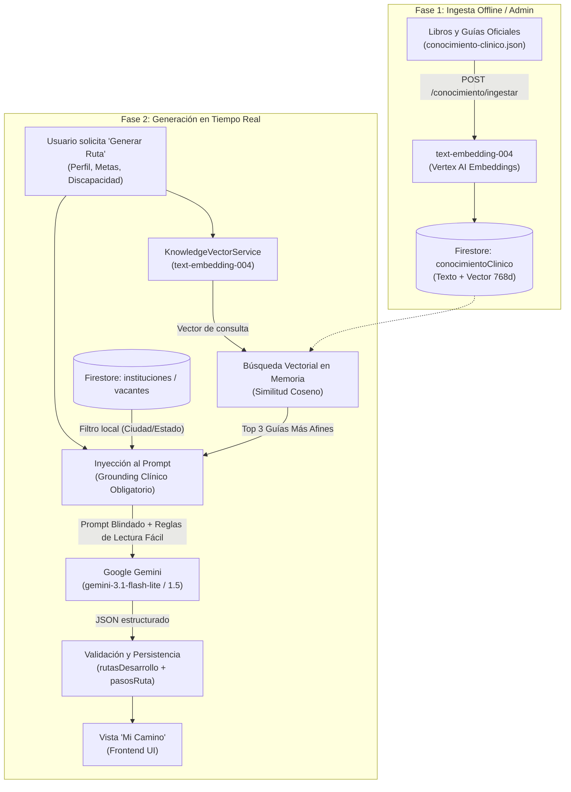

# 🧠 Arquitectura de Inteligencia Artificial en Raíces: RAG, Embeddings y Reglas Clínicas

> **Propósito del documento:** Explicación técnica y conceptual de cómo funciona la Inteligencia Artificial que genera las rutas de desarrollo en Raíces, qué tecnologías utiliza (RAG, modelos de embeddings, LLM) y por qué **NO** es un Fine-Tuning.

---

## 1. 📌 ¿Qué estamos haciendo exactamente?

| Concepto | ¿Aplica en Raíces? | Explicación |
| :--- | :---: | :--- |
| **Fine-Tuning** | ❌ **NO** | En Fine-Tuning se reentrenan los pesos neuronales de un modelo con miles de datos. Aquí **no** modificamos el modelo base de Gemini; se utiliza en su estado preentrenado oficial (*frozen weights*). |
| **Vectorizado Entrenado** | ⚠️ **Uso de modelo preentrenado** | Usamos un modelo de Deep Learning entrenado por Google (`text-embedding-004`) para transformar texto clínico a listas de números (vectores/coordenadas multidimensionales). |
| **RAG (*Retrieval-Augmented Generation*)** | ✅ **SÍ (Núcleo)** | Técnica donde la IA "hace un examen a libro abierto": busca fragmentos de guías oficiales según el caso del usuario y se los entrega al modelo para que responda fundamentado en ellos. |
| **Reglas Clínicas y Guardrails** | ✅ **SÍ (Control estricto)** | Reglas programadas en backend que imponen orden secuencial (Evaluación $\to$ Apoyo $\to$ Inclusión), lenguaje en Lectura Fácil y prohíben alucinaciones o recetas de medicamentos. |

**Definición técnica formal:**  
El sistema es una **Arquitectura Híbrida de RAG (Grounding Semántico Vectorial) con Guardrails de Seguridad Clínica y Orquestación por LLM (Google Gemini)**.

---

## 2. 💡 La Analogía: "Examen de Memoria vs. Examen a Libro Abierto"

* **Fine-Tuning (Examen de memoria):**  
  Sería obligar a un estudiante de medicina a memorizarse 50 guías clínicas y libros. Con el tiempo, o ante preguntas ambiguas, puede inventar cosas ("alucinar") o mezclar conceptos porque su memoria estadística no es 100% infalible. Además, si la ley o una guía médica cambia, habría que pagar miles de dólares y semanas para "reeducar" su memoria neuronal.

* **RAG (Examen a libro abierto — lo que tenemos en Raíces):**  
  El estudiante (Gemini) es muy inteligente redactando y estructurando en lenguaje comprensible (*Lectura Fácil*). Cuando un paciente llega, un bibliotecario matemático de alta velocidad (búsqueda vectorial por similitud de coseno) busca en la biblioteca ([`conocimiento-clinico.json`](../scripts/conocimiento-clinico.json)) exactamente las **3 páginas de guías oficiales** pertinentes para ese diagnóstico y edad. Se las pone sobre la mesa y le dice: *"Redacta los pasos basándote única y exclusivamente en estas hojas oficiales y sigue las reglas médicas de seguridad"*.

---

## 3. 🗺️ Flujo de Arquitectura General



---

## 4. ⚙️ Detalle de Componentes y Código Fuente

### A. Dataset de Conocimiento Clínico
* **Ruta:** [`raices-backend/scripts/conocimiento-clinico.json`](file:///c:/Users/ruizs/Raices/raices-backend/scripts/conocimiento-clinico.json)
* **Contenido:** Fichas estructuradas de evidencia médica y legal:
  * **OMS:** CIF (Clasificación Internacional del Funcionamiento) y CDPD.
  * **CENETEC / SSA:** Guías de Práctica Clínica para Parálisis Cerebral, Hipoacusia Infantil, TEA, Lesión Medular y Amputaciones.
  * **SEP:** Estrategia Nacional de Educación Inclusiva (ENEI), Diseño Universal para el Aprendizaje (DUA), USAER, CAM.
  * **W3C / Accesibilidad:** Pautas WCAG 2.1 / 2.2.
  * **Marco Legal México:** LGIPD, apoyos y salvaguardias.

### B. Ingesta y Vectorización
* **Servicio:** [`KnowledgeVectorService.ts`](file:///c:/Users/ruizs/Raices/raices-backend/src/modules/routes/knowledge-vector.service.ts)
* **Endpoint:** `POST /api/rutas-desarrollo/conocimiento/ingestar` ([`routes.controller.ts`](file:///c:/Users/ruizs/Raices/raices-backend/src/modules/routes/routes.controller.ts))
* Cada objeto del JSON pasa por `this.ai.models.embedContent({ model: 'text-embedding-004', content })`.
* El resultado es un vector de coma flotante que se almacena junto al documento en la colección Firestore `conocimientoClinico`.

### C. Recuperación Semántica (Cálculo Vectorial)
Cuando el usuario presiona "Generar Ruta":
1. Se arma una consulta de búsqueda con su contexto:
   ```text
   Ruta para discapacidad [discapacidad] en [etapaVida] con meta: [metas]
   ```
2. Se genera el embedding de esa consulta.
3. Se compara contra los documentos de Firestore mediante la fórmula matemática de **Similitud Coseno**:
   $$\text{Similitud} = \frac{\mathbf{A} \cdot \mathbf{B}}{\|\mathbf{A}\| \|\mathbf{B}\|}$$
4. Se ordenan de mayor a menor coincidencia y se extraen los **3 mejores**.

### D. Construcción del Prompt y Guardrails
* **Servicio:** [`RoutesService.ts`](file:///c:/Users/ruizs/Raices/raices-backend/src/modules/routes/routes.service.ts#L644-L720)
* En el prompt se inyecta la sección:
  ```text
  --- EVIDENCIA OBLIGATORIA DE CONTEXTO ---
  FUENTE: [...]
  CONTENIDO: [...]
  GUÍA: [...]
  ADVERTENCIAS: [...]
  --- FIN DE EVIDENCIA ---
  ```
* Se aplican **10 reglas inflexibles**:
  1. Rol de Comité Médico y Pedagógico Experto (cero creatividad arbitraria).
  2. Basado estrictamente en CENETEC, OMS y SEP.
  3. **Prohibición total de alucinaciones** (no inventar terapias no avaladas).
  4. **Secuencia médica obligatoria**:
     * *Fase 1:* Diagnóstico clínico y evaluación formal.
     * *Fase 2:* Intervención terapéutica basada en evidencia.
     * *Fase 3:* Inclusión escolar, laboral y social.
  5. **Lectura Fácil:** Cada paso debe iniciar con un verbo de acción amable (*"Visita...", "Acude a...", "Pregunta por...", "Platica con..."*).
  6. Cantidad acotada: entre 5 y 7 pasos.
  7. Formato estricto: Título $\le 100$ caracteres, descripción $\le 200$ caracteres.
  8. Contextualizado a México (DIF, Centros de Salud, CAM, USAER).
  9. Salida exclusivamente en JSON válido.
  10. **Prohibido recetar medicamentos o tratamientos invasivos.**

---

## 5. 🏆 ¿Por qué esta arquitectura es la mejor opción?

1. **Seguridad y Cero Negligencia Médica:**  
   En salud y discapacidad no se le puede permitir a una IA "adivinar". Al inyectar fragmentos exactos de la OMS y CENETEC, las respuestas se mantienen éticas y profesionales.
2. **Mantenibilidad Rápida y Económica:**  
   Si se publica una nueva ley de inclusión o una nueva guía de práctica clínica, basta con agregar una entrada en [`conocimiento-clinico.json`](file:///c:/Users/ruizs/Raices/raices-backend/scripts/conocimiento-clinico.json) y correr el endpoint de ingesta. No requiere semanas de reentrenamiento.
3. **Auditabilidad y Transparencia:**  
   Podemos rastrear exactamente qué guía clínica respaldó cada recomendación entregada al usuario.
4. **Respeto a la Accesibilidad Cognitiva:**  
   Las guías médicas suelen ser técnicas y frías; el LLM actúa como un "traductor empático" que convierte el rigor científico en instrucciones comprensibles para la persona o su familia.

---

## 6. 🛠️ ¿Cómo actualizar o agregar nuevos libros en el futuro?

1. Abrir [`raices-backend/scripts/conocimiento-clinico.json`](file:///c:/Users/ruizs/Raices/raices-backend/scripts/conocimiento-clinico.json).
2. Agregar un nuevo objeto con la estructura:
   ```json
   {
     "knowledge_id": "KB-NUEVO-001",
     "title": "Nombre de la Guía o Libro",
     "category": "Salud / Educación / Legal",
     "disability_or_condition": "Discapacidad aplicable",
     "content": "Resumen técnico de la intervención...",
     "practical_guidance": ["Acción práctica 1", "Acción práctica 2"],
     "limitations_and_warnings": "Advertencias clínicas de seguridad...",
     "source_title": "Nombre de la publicación oficial",
     "source_institution": "OMS / CENETEC / SEP",
     "source_url": "https://..."
   }
   ```
3. Ejecutar la llamada autenticada como administrador:
   ```http
   POST /api/rutas-desarrollo/conocimiento/ingestar
   Content-Type: application/json
   Authorization: Bearer <TOKEN_ADMIN>
   
   [ ...contenido del json... ]
   ```
4. El sistema calculará automáticamente los nuevos vectores y la IA comenzará a utilizar la nueva información en las siguientes rutas generadas.

